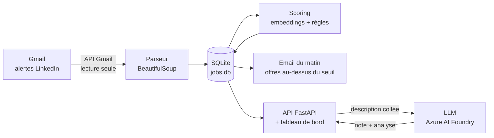
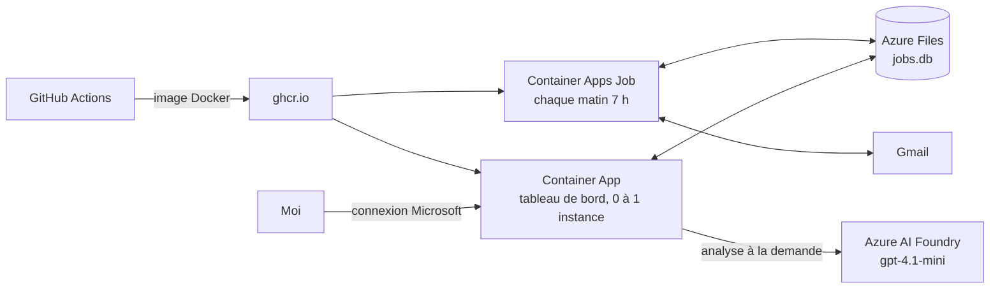

# Job Radar

Job Radar lit chaque matin mes alertes emploi LinkedIn reçues dans Gmail, garde les nouvelles offres,
leur donne une note de 0 à 100 selon mon profil, et m'envoie par email celles qui valent le coup.
Un petit tableau de bord web me permet ensuite de les trier (intéressé, postulé, refusé)
et de demander à un LLM une analyse détaillée d'une offre face à mon profil.

Les candidatures restent envoyées à la main : Job Radar trie, il ne postule jamais à ma place.

## Pourquoi

Les alertes LinkedIn arrivent en vrac : beaucoup d'offres hors sujet (postes seniors, mécanique,
électronique...), et les bonnes se perdent. Job Radar fait le premier tri pour que je ne lise que
les offres pertinentes.

## Comment ça marche



1. **Ingestion** : lecture des emails d'alerte via l'API Gmail, extraction de chaque offre
   (titre, entreprise, lieu, mode de travail, lien).
2. **Stockage** : les offres vont dans une base SQLite. L'identifiant LinkedIn de l'offre sert de clé,
   donc une offre reçue deux fois n'est enregistrée qu'une fois.
3. **Scoring** : chaque titre est comparé aux postes que je vise grâce à un modèle d'embeddings
   multilingue (FR, EN, ES). "Científico de datos" et "Data Scientist" sont donc reconnus comme proches.
   Des règles simples ajustent ensuite la note : exclusion de certains domaines, pénalité pour les postes
   seniors ou exigeant le néerlandais, bonus pour les postes juniors.
4. **Résumé quotidien** : un email récapitule les nouvelles offres au-dessus d'un seuil (70 par défaut).
5. **Tableau de bord** : une API FastAPI liste les offres (tri sur chaque colonne) et permet de changer
   leur statut. La colonne "Modifié le" affiche la date du dernier changement, sinon la date d'ajout.
6. **Analyse par LLM, à la demande** : les alertes LinkedIn ne contiennent pas la description des offres.
   Sur une offre qui m'intéresse, je clique sur "Analyser" et je colle sa description. Un modèle
   (`gpt-4.1-mini` sur Azure AI Foundry) la compare à `profile.md` et renvoie, en JSON structuré, une note
   sur 100, un verdict, mes points forts, mes écarts et les exigences bloquantes. Le prompt lui interdit
   d'inventer des compétences. Le résultat est gardé en base (colonne "IA").
7. **CV adapté à une offre** : le bouton "Générer CV" construit un CV d'une page à partir de `cv_base.json`,
   une base de faits vrais (expériences, puces, compétences, en FR et EN). Le LLM ne rédige que le titre et
   le court profil. Pour le reste, il renvoie seulement des identifiants de la base, et le code supprime tout
   identifiant inconnu : il peut choisir et ordonner, pas inventer. Les compétences demandées par l'offre mais
   absentes de la base sont listées à part, sans être ajoutées. La page s'ouvre, se modifie au clic et
   s'imprime en PDF. Les coordonnées ne sont jamais envoyées au LLM.

## Stack

| Besoin | Outil |
| --- | --- |
| Langage | Python 3.13 |
| Emails | API Gmail (OAuth 2.0) |
| Extraction HTML | BeautifulSoup |
| Base de données | SQLite |
| Similarité sémantique | sentence-transformers (`paraphrase-multilingual-MiniLM-L12-v2`) |
| Analyse détaillée | Azure AI Foundry (`gpt-4.1-mini`), SDK `openai`, sorties structurées JSON |
| API et tableau de bord | FastAPI, Uvicorn |
| Tests | pytest |
| Déploiement | Docker, GitHub Actions, Azure Container Apps, Azure Files, Microsoft Entra ID |

## Structure du projet

```
src/jobradar/
    gmail_client.py   connexion Gmail, lecture des alertes, envoi du résumé
    parser.py         extraction des offres depuis le HTML des emails LinkedIn
    db.py             base SQLite (création, ajout sans doublons, requêtes)
    ingest.py         pipeline Gmail -> parseur -> base
    scoring.py        note 0-100 : embeddings + règles métier
    llm_scoring.py    analyse d'une offre par le LLM, à partir de sa description
    cv.py             CV adapté : choix dans cv_base.json par le LLM, contrôle, page imprimable
    rank.py           note les offres pas encore notées, affiche le top
    daily.py          routine du matin : ingestion, scoring, email
    api.py            API FastAPI
    static/           tableau de bord HTML
tests/                tests pytest (le LLM est remplacé par un faux client)
profile.md            mon profil de recherche, lu par le LLM
cv_base.json          base de faits du CV (hors image, envoyée sur Azure Files par le pipeline)
```

## Installation en local (Windows)

```powershell
git clone https://github.com/Mustafalou/Job-Radar.git
cd Job-Radar
python -m venv .venv
.venv\Scripts\activate
pip install -r requirements.txt
copy .env.example .env      # puis remplir les valeurs
```

Pour l'accès Gmail, il faut un projet Google Cloud avec l'API Gmail activée et un identifiant OAuth
de type "application de bureau", téléchargé sous le nom `credentials.json` à la racine du projet.
Au premier lancement, une page Google s'ouvre pour autoriser l'accès, puis `token.json` est créé.
Ces deux fichiers sont des secrets : ils sont exclus de git.

## Configuration

| Variable | Rôle | Valeur par défaut |
| --- | --- | --- |
| `GMAIL_QUERY` | recherche Gmail qui trouve les emails d'alerte | voir `.env.example` |
| `DIGEST_TO` | adresse qui reçoit le résumé du matin | aucune (obligatoire pour l'email) |
| `DIGEST_MIN_SCORE` | note minimale pour figurer dans le résumé | `70` |
| `DASHBOARD_URL` | lien du tableau de bord dans l'email | `http://127.0.0.1:8000` |
| `JOBRADAR_DB` | chemin de la base SQLite | `data/jobs.db` |
| `GMAIL_TOKEN_JSON` | contenu de `token.json` (utilisé dans le cloud à la place du fichier) | aucune |
| `AZURE_OPENAI_ENDPOINT` | adresse de la ressource Foundry (le chemin éventuel est ignoré) | aucune (obligatoire pour l'analyse) |
| `AZURE_OPENAI_API_KEY` | clé de la ressource Foundry | aucune (obligatoire pour l'analyse) |
| `AZURE_OPENAI_DEPLOYMENT` | nom du déploiement du modèle | `gpt-4.1-mini` |
| `CV_PHONE` | téléphone affiché sur le CV (secret Container Apps) | aucun |
| `CV_BASE_PATH` | chemin de `cv_base.json` | `cv_base.json` (`/data/cv_base.json` dans l'image) |
| `PROFILE_PATH` | chemin de `profile.md` | `profile.md` (`/data/profile.md` dans l'image) |

## Utilisation

```powershell
$env:PYTHONPATH="src"
python -m jobradar.ingest            # lire les alertes et remplir la base
python -m jobradar.rank              # noter les offres et afficher le top 10
python -m jobradar.daily             # routine complète + email
uvicorn jobradar.api:app --reload    # tableau de bord sur http://127.0.0.1:8000
pytest                               # lancer les tests
```

La documentation interactive de l'API est disponible sur http://127.0.0.1:8000/docs.

## Déploiement sur Azure

Job Radar tourne sur Azure (région France Central), pour un coût visé de moins de 1 € par mois.



- **Image** : construite par GitHub Actions à chaque push sur `main`, publiée sur GitHub Container Registry. Une seule image sert aux deux usages.
- **Déploiement continu** : après la construction, le pipeline se connecte à Azure sans mot de passe (OIDC, identité limitée au groupe de ressources), met à jour le tableau de bord et la routine avec l'image du commit, puis envoie `profile.md` et `cv_base.json` sur le partage Azure Files.
- **Tableau de bord** : Azure Container App, de 0 à 1 instance. Il s'éteint quand personne ne l'utilise, donc il ne coûte rien au repos.
- **Routine du matin** : Container Apps Job planifié (`0 6 * * *` UTC), 1 vCPU et 2 Gio pour charger le modèle d'embeddings.
- **Base** : le fichier SQLite est sur un partage Azure Files monté sur `/data` dans les deux conteneurs (option `nobrl` pour le verrouillage SQLite). Une seule instance du tableau de bord au maximum, donc jamais deux écrivains en même temps.
- **Secrets** : le token Gmail et la clé Foundry sont des secrets Container Apps, injectés en variables d'environnement, jamais inclus dans l'image.
- **Profil et base du CV** : `profile.md` et `cv_base.json` ne sont pas dans l'image publique. Ils sont lus sur le partage Azure Files (`/data/`). Les deux sont envoyés automatiquement par le pipeline à chaque push. Le téléphone affiché sur le CV n'est pas dans git : il vient du secret `CV_PHONE`.
- **LLM** : ressource Azure AI Foundry avec un déploiement `gpt-4.1-mini` (Global Standard). Moins d'un centime par analyse.
- **Accès** : le tableau de bord est protégé par l'authentification intégrée de Container Apps (Microsoft Entra ID, un seul locataire).
- **Coûts** : budget Azure avec alertes à 5 € par mois.

## Données et confidentialité

- Accès Gmail en **lecture seule** pour les alertes. Le seul envoi est le résumé, à ma propre adresse.
- Aucune lecture automatique de LinkedIn : la description d'une offre est collée à la main, ce qui respecte les CGU de LinkedIn.
- Les descriptions et mon profil sont envoyés uniquement à mon propre déploiement Azure AI Foundry.
- Les données restent sur ma machine ou dans mon propre compte Azure.
- Les secrets (`.env`, `credentials.json`, `token.json`) et la base ne sont jamais versionnés.

## Prochaines étapes

- Parseur pour les alertes Indeed
- Lettre de motivation adaptée (le début restera écrit à la main)
- Suivi des candidatures et rappels de relance
