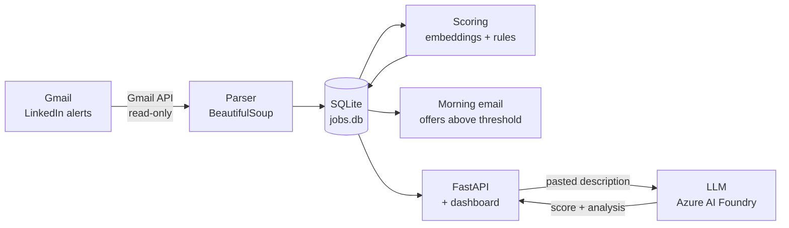
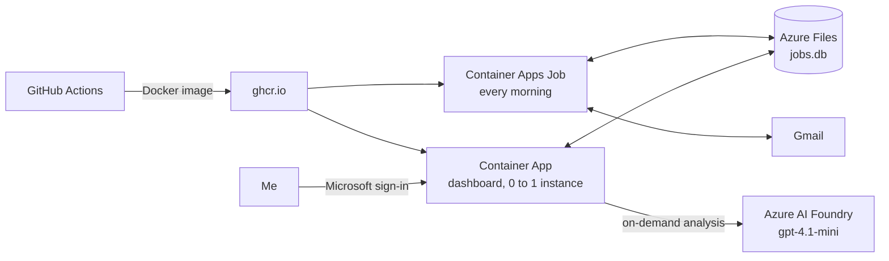

# Job Radar

**English** | [Français](README.fr.md)

Every morning, Job Radar reads the LinkedIn job alerts I receive in Gmail, keeps the new offers,
scores them from 0 to 100 against my profile, and emails me the ones worth reading.
A small web dashboard then lets me sort them (interested, applied, rejected)
and ask an LLM for a detailed analysis of an offer against my profile.

Applications are still sent by hand: Job Radar sorts, it never applies for me.

## Why

LinkedIn alerts arrive in bulk: many off-topic offers (senior roles, mechanical,
electronics...), and the good ones get lost. Job Radar does the first sort so I only read
the relevant offers.

## How it works



1. **Ingestion**: alert emails are read through the Gmail API, and each offer is extracted
   (title, company, location, work mode, link).
2. **Storage**: offers go into a SQLite database. The LinkedIn job ID is the key,
   so an offer received twice is stored once.
3. **Scoring**: each title is compared to the roles I am looking for with a multilingual embeddings
   model (FR, EN, ES), so "Científico de datos" and "Data Scientist" are recognised as close.
   Simple rules then adjust the score: some fields are excluded, senior roles or roles requiring
   Dutch get a penalty, junior roles get a bonus.
4. **Daily digest**: one email lists the new offers above a threshold (70 by default).
5. **Dashboard**: a FastAPI app lists the offers (every column is sortable) and lets me change
   their status. The "Modified" column shows the last status change, or else the date added.
6. **On-demand LLM analysis**: LinkedIn alerts do not contain the job description.
   On an offer I like, I click "Analyze" and paste its description. A model
   (`gpt-4.1-mini` on Azure AI Foundry) compares it to `profile.md` and returns, as structured JSON,
   a score out of 100, a verdict, my strengths, my gaps and the blocking requirements. The prompt forbids
   inventing skills. The result is stored in the database ("AI" column).
7. **CV tailored to an offer**: the "Generate CV" button builds a one-page CV from `cv_base.json`,
   a base of true facts (experiences, bullet points, skills, in FR and EN). The LLM only writes the
   headline and the short summary. For everything else it returns IDs from the base, and the code drops
   any unknown ID: it can choose and order, not invent. Skills the offer asks for but that are missing
   from the base are listed separately, never added. The page opens, can be edited by clicking, and
   prints to PDF. Contact details are never sent to the LLM. The version actually sent can be saved.

## Stack

| Need | Tool |
| --- | --- |
| Language | Python 3.13 |
| Emails | Gmail API (OAuth 2.0) |
| HTML extraction | BeautifulSoup |
| Database | SQLite |
| Semantic similarity | sentence-transformers (`paraphrase-multilingual-MiniLM-L12-v2`) |
| Detailed analysis | Azure AI Foundry (`gpt-4.1-mini`), `openai` SDK, structured JSON outputs |
| API and dashboard | FastAPI, Uvicorn |
| Tests | pytest |
| Deployment | Bicep, Docker, GitHub Actions, Azure Container Apps, Azure Files, Azure Key Vault, managed identities, Microsoft Entra ID |

## Project structure

```
src/jobradar/
    gmail_client.py   Gmail connection, reading alerts, sending the digest
    parser.py         extracts offers from the HTML of LinkedIn emails
    db.py             SQLite database (creation, insert without duplicates, queries)
    ingest.py         pipeline Gmail -> parser -> database
    scoring.py        0-100 score: embeddings + business rules
    llm_scoring.py    LLM analysis of an offer from its description
    cv.py             tailored CV: LLM picks from cv_base.json, checks, printable page
    rank.py           scores offers not scored yet, prints the top
    daily.py          morning routine: ingestion, scoring, email
    api.py            FastAPI app
    static/           HTML dashboard
tests/                pytest tests (the LLM is replaced by a fake client)
profile.md            my job search profile, read by the LLM
cv_base.json          CV facts base (not in the image, uploaded to Azure Files by the pipeline)
docs/                 Azure setup guide (EN and FR)
deploy/               Container Apps templates
infra/main.bicep      the whole Azure infrastructure as code (Bicep)
```

## Run your own copy

The guide [docs/azure-setup.md](docs/azure-setup.md) explains step by step how to deploy
Job Radar on your own Azure account, with your own resource names: Gmail access, storage,
Container Apps, Key Vault, Azure AI Foundry, Microsoft sign-in and automatic deployment from GitHub.
The whole infrastructure can also be created with one command from `infra/main.bicep`.
The names used in this repository (`rg-jobradar`, `stjobradarmay`...) are mine: the pipeline reads
yours from the GitHub repository variables.

## Local setup (Windows)

```powershell
git clone https://github.com/Mustafalou/Job-Radar.git
cd Job-Radar
python -m venv .venv
.venv\Scripts\activate
pip install -r requirements.txt
copy .env.example .env      # then fill in the values
```

Gmail access needs a Google Cloud project with the Gmail API enabled and an OAuth client
of type "Desktop app", downloaded as `credentials.json` at the root of the project.
On the first run, a Google page opens to grant access, then `token.json` is created.
Both files are secrets: they are excluded from git.

## Configuration

| Variable | Purpose | Default |
| --- | --- | --- |
| `GMAIL_QUERY` | Gmail search that finds the alert emails | see `.env.example` |
| `DIGEST_TO` | address that receives the morning digest | none (required for the email) |
| `DIGEST_MIN_SCORE` | minimum score to appear in the digest | `70` |
| `DASHBOARD_URL` | dashboard link in the email | `http://127.0.0.1:8000` |
| `JOBRADAR_DB` | path of the SQLite database | `data/jobs.db` |
| `GMAIL_TOKEN_JSON` | content of `token.json` (used in the cloud instead of the file) | none |
| `AZURE_OPENAI_ENDPOINT` | Foundry resource address (any path is ignored) | none (required for the analysis) |
| `AZURE_OPENAI_API_KEY` | Foundry key (optional: without it, managed identity or `az login`) | none |
| `AZURE_OPENAI_DEPLOYMENT` | model deployment name | `gpt-4.1-mini` |
| `CV_PHONE` | phone number shown on the CV (Container Apps secret) | none |
| `CV_BASE_PATH` | path of `cv_base.json` | `cv_base.json` (`/data/cv_base.json` in the image) |
| `PROFILE_PATH` | path of `profile.md` | `profile.md` (`/data/profile.md` in the image) |

## Usage

```powershell
$env:PYTHONPATH="src"
python -m jobradar.ingest            # read the alerts and fill the database
python -m jobradar.rank              # score the offers and print the top 10
python -m jobradar.daily             # full routine + email
uvicorn jobradar.api:app --reload    # dashboard on http://127.0.0.1:8000
pytest                               # run the tests
```

The interactive API documentation is available at http://127.0.0.1:8000/docs.

## Deployment on Azure

Job Radar runs on Azure (France Central region), with a target cost below €1 per month.



- **Image**: built by GitHub Actions on every push to `main`, published to GitHub Container Registry. One image serves both uses.
- **Continuous deployment**: after the build, the pipeline signs in to Azure without a password (OIDC, identity limited to the resource group), updates the dashboard and the routine with the commit's image, then uploads `profile.md` and `cv_base.json` to the Azure Files share.
- **Dashboard**: Azure Container App, 0 to 1 instance. It shuts down when nobody uses it, so it costs nothing at rest.
- **Morning routine**: scheduled Container Apps Job (`0 6 * * *` UTC), 1 vCPU and 2 GiB to load the embeddings model.
- **Database**: the SQLite file lives on an Azure Files share mounted on `/data` in both containers (`nobrl` option for SQLite locking). At most one dashboard instance, so never two writers at the same time.
- **Secrets**: the Gmail token and the CV phone number are in **Azure Key Vault**. Container Apps secrets are only references, read by each app's managed identity ("Key Vault Secrets User" role). Nothing is baked into the image.
- **Keyless LLM**: the app calls Azure AI Foundry with its **managed identity** (Microsoft Entra ID, "Cognitive Services User" role on the Foundry account). No API key is stored; `AZURE_OPENAI_API_KEY` is only for local runs.
- **Profile and CV base**: `profile.md` and `cv_base.json` are not in the public image. They are read from the Azure Files share (`/data/`) and uploaded automatically by the pipeline on every push. The phone number on the CV is not in git: it comes from the `CV_PHONE` secret.
- **LLM**: Azure AI Foundry resource with a `gpt-4.1-mini` deployment (Global Standard). Less than one cent per analysis.
- **Access**: the dashboard is protected by Container Apps built-in authentication (Microsoft Entra ID, single tenant).
- **Costs**: Azure budget with alerts at €5 per month.

## Data and privacy

- Gmail access is **read-only** for the alerts. The only email sent is the digest, to my own address.
- LinkedIn is never read automatically: the description of an offer is pasted by hand, which respects LinkedIn's terms of service.
- Descriptions and my profile are sent only to my own Azure AI Foundry deployment.
- Data stays on my machine or in my own Azure account.
- Secrets (`.env`, `credentials.json`, `token.json`) and the database are never committed.

## Next steps

- Parser for Indeed alerts
- Tailored cover letter (the opening will stay handwritten)
- Application tracking and follow-up reminders
