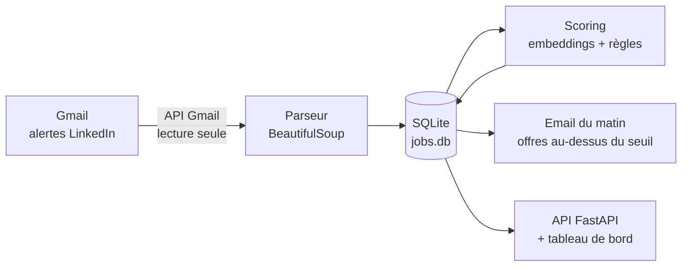

# Job Radar

Job Radar lit chaque matin mes alertes emploi LinkedIn reçues dans Gmail, garde les nouvelles offres,
leur donne une note de 0 à 100 selon mon profil, et m'envoie par email celles qui valent le coup.
Un petit tableau de bord web me permet ensuite de les trier (intéressé, postulé, refusé).

Les candidatures restent envoyées à la main : Job Radar trie, il ne postule jamais à ma place.

## Pourquoi

Les alertes LinkedIn arrivent en vrac : beaucoup d'offres hors sujet (postes seniors, mécanique,
électronique...), et les bonnes se perdent. Job Radar fait le premier tri pour que je ne lise que
les offres pertinentes.

## Comment ça marche



1. **Ingestion** : lecture des emails d'alerte via l'API Gmail, extraction de chaque offre
   (titre, entreprise, lieu, mode de travail, lien).
2. **Stockage** : les offres vont dans une base SQLite. L'identifiant LinkedIn de l'offre sert de clé,
   donc une offre reçue deux fois n'est enregistrée qu'une fois.
3. **Scoring** : chaque titre est comparé aux postes que je vise grâce à un modèle d'embeddings
   multilingue (FR, EN, ES). "Científico de datos" et "Data Scientist" sont donc reconnus comme proches.
   Des règles simples ajustent ensuite la note : exclusion de certains domaines, pénalité pour les postes
   seniors ou exigeant le néerlandais, bonus pour les postes juniors.
4. **Résumé quotidien** : un email récapitule les nouvelles offres au-dessus d'un seuil (70 par défaut).
5. **Tableau de bord** : une API FastAPI liste les offres triées par note et permet de changer leur statut.

## Stack

| Besoin | Outil |
| --- | --- |
| Langage | Python 3.13 |
| Emails | API Gmail (OAuth 2.0) |
| Extraction HTML | BeautifulSoup |
| Base de données | SQLite |
| Similarité sémantique | sentence-transformers (`paraphrase-multilingual-MiniLM-L12-v2`) |
| API et tableau de bord | FastAPI, Uvicorn |
| Tests | pytest |
| Déploiement | Docker, GitHub Actions, Azure Container Apps (en cours) |

## Structure du projet

```
src/jobradar/
    gmail_client.py   connexion Gmail, lecture des alertes, envoi du résumé
    parser.py         extraction des offres depuis le HTML des emails LinkedIn
    db.py             base SQLite (création, ajout sans doublons, requêtes)
    ingest.py         pipeline Gmail -> parseur -> base
    scoring.py        note 0-100 : embeddings + règles métier
    rank.py           note les offres pas encore notées, affiche le top
    daily.py          routine du matin : ingestion, scoring, email
    api.py            API FastAPI
    static/           tableau de bord HTML
tests/                tests pytest
```

## Installation en local (Windows)

```powershell
git clone https://github.com/Mustafalou/Job-Radar.git
cd Job-Radar
python -m venv .venv
.venv\Scripts\activate
pip install -r requirements.txt
copy .env.example .env      # puis remplir les valeurs
```

Pour l'accès Gmail, il faut un projet Google Cloud avec l'API Gmail activée et un identifiant OAuth
de type "application de bureau", téléchargé sous le nom `credentials.json` à la racine du projet.
Au premier lancement, une page Google s'ouvre pour autoriser l'accès, puis `token.json` est créé.
Ces deux fichiers sont des secrets : ils sont exclus de git.

## Configuration

| Variable | Rôle | Valeur par défaut |
| --- | --- | --- |
| `GMAIL_QUERY` | recherche Gmail qui trouve les emails d'alerte | voir `.env.example` |
| `DIGEST_TO` | adresse qui reçoit le résumé du matin | aucune (obligatoire pour l'email) |
| `DIGEST_MIN_SCORE` | note minimale pour figurer dans le résumé | `70` |
| `DASHBOARD_URL` | lien du tableau de bord dans l'email | `http://127.0.0.1:8000` |
| `JOBRADAR_DB` | chemin de la base SQLite | `data/jobs.db` |
| `GMAIL_TOKEN_JSON` | contenu de `token.json` (utilisé dans le cloud à la place du fichier) | aucune |

## Utilisation

```powershell
$env:PYTHONPATH="src"
python -m jobradar.ingest            # lire les alertes et remplir la base
python -m jobradar.rank              # noter les offres et afficher le top 10
python -m jobradar.daily             # routine complète + email
uvicorn jobradar.api:app --reload    # tableau de bord sur http://127.0.0.1:8000
pytest                               # lancer les tests
```

La documentation interactive de l'API est disponible sur http://127.0.0.1:8000/docs.

## Déploiement sur Azure (en cours)

Objectif : faire tourner Job Radar dans le cloud pour moins de 1 € par mois.

- L'image Docker est construite par GitHub Actions à chaque push sur `main` et publiée sur GitHub Container Registry.
- Le tableau de bord tourne sur **Azure Container Apps**, de 0 à 1 instance (il s'éteint quand personne ne l'utilise).
- La routine du matin tourne en **Container Apps Job** planifié.
- La base SQLite est stockée sur un partage **Azure Files**, partagé entre les deux.
- Le token Gmail est un secret Azure, jamais inclus dans l'image.

## Données et confidentialité

- Accès Gmail en **lecture seule** pour les alertes. Le seul envoi est le résumé, à ma propre adresse.
- Les données restent sur ma machine ou dans mon propre compte Azure.
- Les secrets (`.env`, `credentials.json`, `token.json`) et la base ne sont jamais versionnés.

## Prochaines étapes

- Parseur pour les alertes Indeed
- Note affinée par un LLM pour les meilleures offres
- Génération d'un CV et d'une lettre adaptés à une offre
- Suivi des candidatures et rappels de relance
